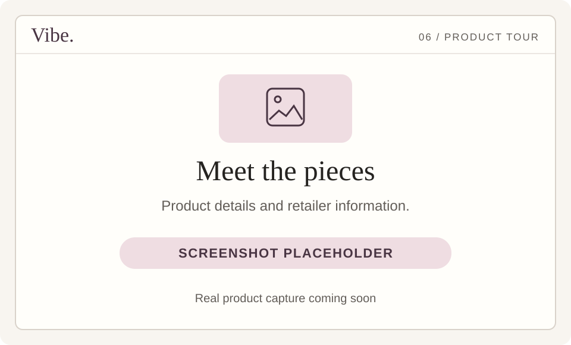

<div align="center">


### Your plans. Your style. Your Vibe.

Outfit ideas for your occasion. New ways to wear what you own. A virtual preview before your next step.

[](https://vibe-consumer-web.vercel.app/) &nbsp; [](https://github.com/jaychitransh007/Vibe-Shopping/blob/main/docs/DEMO.md) &nbsp; [](#find-your-vibe)

[Chat](https://vibe-consumer-web.vercel.app/) · [Looks](https://vibe-consumer-web.vercel.app/looks.html) · [Wardrobe](https://vibe-consumer-web.vercel.app/wardrobe.html) · [Profile](https://vibe-consumer-web.vercel.app/profile.html) · [Support](https://vibe-consumer-web.vercel.app/support.html)

**Shopping in India and the United States · Mobile sign-in · For adults 18+**

</div>

## A little inspiration, a lot more you

Tell Vibe what’s on your calendar, the pieces you like, and your budget. Explore clothing suggestions, understand the choices, and refine the look in conversation. Start with a garment you own or discover something new from retailer products.

[](https://github.com/jaychitransh007/Vibe-Shopping/blob/main/docs/DEMO.md)

**Video placeholder — recording coming soon.** [Follow the written tour](https://github.com/jaychitransh007/Vibe-Shopping/blob/main/docs/DEMO.md) or [try the app now ↗](https://vibe-consumer-web.vercel.app/).

## Find your Vibe

Open a starting point below, copy the prompt, and try it after onboarding.

<details open>
<summary><strong>I have somewhere to be · Find an outfit</strong></summary>

```text
Find me a relaxed dinner outfit under ₹8,000.
I like black and earth tones. Nothing too formal.
```

Tell Vibe the occasion, a budget in your shopping currency, and what you want the look to feel like. Browse the outfit carousel and open a piece to inspect it.

[Try it in Vibe ↗](https://vibe-consumer-web.vercel.app/) · [More prompts](https://github.com/jaychitransh007/Vibe-Shopping/blob/main/docs/TRY_VIBE.md)

</details>

<details>
<summary><strong>I already own a piece · Style my wardrobe</strong></summary>

Upload a garment in Wardrobe, or attach a garment photo in Chat. Then say:

```text
I already own this linen shirt.
Help me style it for a casual dinner.
Only suggest new pieces for the rest of the look.
```

[Open Wardrobe ↗](https://vibe-consumer-web.vercel.app/wardrobe.html) · [Open Chat ↗](https://vibe-consumer-web.vercel.app/)

</details>

<details>
<summary><strong>I like part of this look · Make it more me</strong></summary>

```text
In outfit 2, keep the shirt and change the trousers.
Make the look less formal and keep my original budget.
```

Refer to the outfit you mean and explain what should stay. You can also ask why a recommendation works or ask a style question without shopping.

[Continue in Vibe ↗](https://vibe-consumer-web.vercel.app/) · [Try more examples](https://github.com/jaychitransh007/Vibe-Shopping/blob/main/docs/TRY_VIBE.md)

</details>

## More than a list of clothes

| Explore | What you can do | Open |
| --- | --- | --- |
| **Personal styling** | Ask for outfits, a single piece, a new direction, or advice without products. | [Chat ↗](https://vibe-consumer-web.vercel.app/) |
| **Your wardrobe** | Upload garment photos and use an owned piece as your starting point. | [Wardrobe ↗](https://vibe-consumer-web.vercel.app/wardrobe.html) |
| **Virtual try-on** | Generate a preview on eligible looks and revisit it later. | [Looks ↗](https://vibe-consumer-web.vercel.app/looks.html) |
| **Product details** | Read descriptions, prices, explanations, and available retailer evidence. | [Feature guide](https://github.com/jaychitransh007/Vibe-Shopping/blob/main/docs/FEATURES.md#product-details-and-retailer-links) |
| **Saved favorites** | Save outfits, filter history, and shortlist individual products with the wishlist action. | [Looks ↗](https://vibe-consumer-web.vercel.app/looks.html) |
| **Sharing** | Share a generated look through a share sheet or copied link. | [Sharing guide](https://github.com/jaychitransh007/Vibe-Shopping/blob/main/docs/FEATURES.md#sharing) |
| **Style profile** | Review and edit details, measurements, photos, and analysis. | [Profile ↗](https://vibe-consumer-web.vercel.app/profile.html) |
| **Retailer discovery** | Browse the directory and submit a store for compatibility checks. | [Retailers ↗](https://vibe-consumer-web.vercel.app/retailers.html) |
| **Your ideas** | Request features and vote for the ones you would use. | [Feature board ↗](https://vibe-consumer-web.vercel.app/feature-requests.html) |
| **Account and help** | Read privacy information, manage your data, and report problems. | [Support ↗](https://vibe-consumer-web.vercel.app/support.html) |

[Explore the complete feature guide →](https://github.com/jaychitransh007/Vibe-Shopping#explore-the-features)

## Take a look around

**Screenshot placeholders — real product captures coming soon.** Click a panel to open that part of Vibe or its guide.

| Your style profile | Outfit discovery |
| --- | --- |
| [](https://vibe-consumer-web.vercel.app/profile.html) | [](https://vibe-consumer-web.vercel.app/) |
| [](https://vibe-consumer-web.vercel.app/wardrobe.html) | [](https://github.com/jaychitransh007/Vibe-Shopping/blob/main/docs/FEATURES.md#virtual-try-on) |
| [](https://vibe-consumer-web.vercel.app/looks.html) | [](https://github.com/jaychitransh007/Vibe-Shopping/blob/main/docs/FEATURES.md#product-details-and-retailer-links) |

## Your first look starts here

**[Open Vibe ↗](https://vibe-consumer-web.vercel.app/)** → verify your mobile number → complete your profile, measurements, headshot, and full-body photo → wait for style analysis → tell Vibe your plans.

The app detects India / INR or United States / USD from your network location. Account pages require sign-in. Purchases take place on the retailer’s site; confirm its final product details. Virtual try-on is an AI-generated visualization.

[Getting started](https://github.com/jaychitransh007/Vibe-Shopping/blob/main/docs/GETTING_STARTED.md) · [FAQ](https://github.com/jaychitransh007/Vibe-Shopping/blob/main/docs/FAQ.md) · [What’s next](https://github.com/jaychitransh007/Vibe-Shopping/blob/main/docs/ROADMAP.md) · [Privacy](https://vibe-consumer-web.vercel.app/privacy.html) · [Terms](https://vibe-consumer-web.vercel.app/terms.html)

<details>
<summary><strong>Curious about the engineering?</strong></summary>

Vibe connects a JavaScript consumer application, a Python recommendation engine, style knowledge, retailer evidence, and conversation state. [Read the engineering case study](projects/vibe.md) or [explore the public project guide](https://github.com/jaychitransh007/Vibe-Shopping).

The application source is private. The product guide, feature walkthroughs, and media live in the public showcase, independently of application deployments.

</details>

---

Built by **Mrityunjay Nigam** · [Use Vibe ↗](https://vibe-consumer-web.vercel.app/) · [Suggest a feature](https://vibe-consumer-web.vercel.app/feature-requests.html) · [Get help](https://vibe-consumer-web.vercel.app/support.html)
