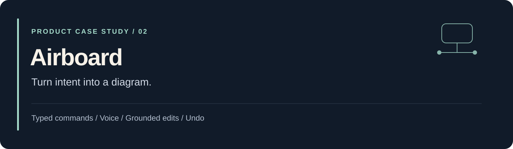
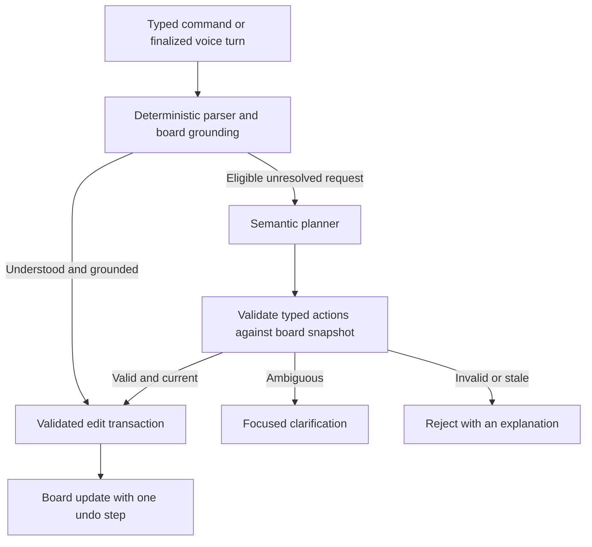

[← Portfolio](../README.md) · [Source and setup](https://github.com/jaychitransh007/Airboard)

# Airboard: an intent-driven diagram canvas

**Product:** diagram editing through typed commands, voice, pointer input, and camera gestures. **Status:** local-first prototype.

## The problem

During a discussion, the idea often arrives before the diagram. Creating a node, naming it, connecting it, and arranging it can break the flow of explaining a system.

Airboard's Intent Canvas explores a direct interaction: describe a change, ground it in the current board, and apply it. Pointer and gesture input supply selection and placement context. Undo provides a way to reverse an accepted edit.

## Example interaction

1. Type “add a circle here” with a pointer location available.
2. Select an element and ask to rename it to “Payments”.
3. Connect named elements or describe a branching diagram.
4. If a reference is incomplete, answer a focused clarification.
5. Undo an accepted multi-action plan as one transaction.

These examples illustrate the documented interaction model. Exact accepted phrasing and browser/hardware requirements are described in the [implementation notes](https://github.com/jaychitransh007/Airboard/blob/main/Docs/Intent%20Canvas%20Implementation%20Notes.md).

## Command flow

## The engineering story

| Decision | Why it matters | Tradeoff |
| --- | --- | --- |
| Parse familiar commands locally first | Common edits avoid a provider round trip. | The grammar needs clear coverage and rejection behavior. |
| Keep transcription and interpretation separate | A speech transcript is not yet permission to mutate a board. | More interfaces and failure states must be coordinated. |
| Request typed actions from a model | A proposed plan can be validated and grounded before execution. | Schema correctness alone cannot establish that the plan matches intent. |
| Bind interpretation to a board snapshot | A delayed result cannot silently target a board that has changed. | Some edits are rejected and need to be repeated. |
| Apply accepted plans atomically | A multi-action edit has a coherent undo boundary. | Transaction and reference resolution require careful implementation. |

The model proposes a plan; application code decides whether it is acceptable and applies it. Voice can use a provider-neutral WebSocket gateway, while the first documented transcription adapter uses Deepgram. Semantic interpretation has a separate server-side provider configuration.

## Explore the implementation

- [Repository README](https://github.com/jaychitransh007/Airboard#readme): architecture, provider configuration, and limits.
- [Intent Canvas notes](https://github.com/jaychitransh007/Airboard/blob/main/Docs/Intent%20Canvas%20Implementation%20Notes.md): supported interactions and test path.
- [Workspace scripts](https://github.com/jaychitransh007/Airboard/blob/main/package.json): development, build, type checks, tests, and voice evaluation entry points.
- [Evaluation directory](https://github.com/jaychitransh007/Airboard/tree/main/evals): inspect the available regression cases.

## Run and verify

Follow the repository's current setup instructions. The documented local sequence starts Supabase, resets and seeds local data, and runs the web and API services. **Database reset is for a disposable local development instance.** Voice transcription and semantic interpretation have separate optional credentials; canonical typed commands retain their deterministic route without those providers.

The repository defines `pnpm typecheck`, `pnpm test`, and `pnpm eval:voice`. Voice evaluation reports outcomes and timing for the selected corpus and configured provider. This portfolio does not claim a fresh passing run, a latency benchmark, or production readiness.

## Current boundaries

The README identifies additional authentication and diagnostic-data controls needed before public service exposure. Browser, microphone, and camera support also affect the experience. This page describes the documented prototype reviewed on **23 October 2026**; meeting-platform integration and a general production deployment are separate work.
