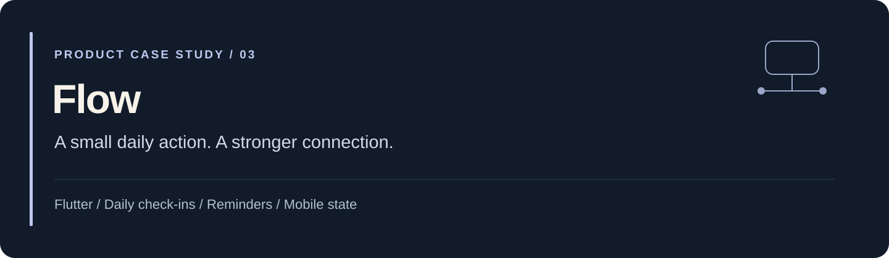
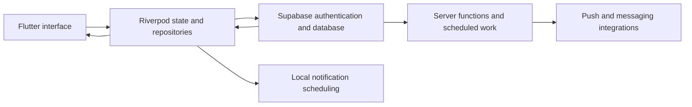

[← Portfolio](../README.md) · [Source and setup](https://github.com/jaychitransh007/TheSigmaFlow)

# Flow: daily check-ins built around mobile state

**Product:** a daily check-in and connection application. **Stack:** Flutter, Dart, Riverpod, GoRouter, and Supabase.

## The problem

A daily check-in can be a very small interaction. Supporting it consistently is a larger engineering task: authentication, saved preferences, the user's local time, device permissions, reminders, and what happens when the check-in is missed.

Flow organizes the experience around a daily rhythm, community interaction, and a nominated contact. The product documentation describes a progression from check-in to reminders and escalation.

## User journey

1. Verify identity and set up a profile.
2. Choose a daily check-in time and nominate a contact.
3. Enable the required device permissions.
4. Check in through the home screen.
5. Receive the appropriate reminder or connection prompt when the check-in is missed.

Returning users have a separate path: recover the saved profile, preserve preferences, and synchronize permissions on the current device.

## Architecture at a glance

This is a conceptual component map. The configured delivery channels and timing rules should be checked in the current code and environment.

## Engineering decisions

| Problem | Approach described in the repository | What needs verification |
| --- | --- | --- |
| A reinstall should not erase onboarding context | Recover the saved profile and bypass already-completed setup. | New-device permissions and auth/profile race conditions. |
| Home state depends on a schedule | Derive the visible check-in state from persisted data and time. | Date changes, time zones, and reminder timing. |
| App startup can race platform initialization | Use a dedicated initializer for backend and environment setup. | Cold start and physical-device behavior. |
| Device and server notifications have different jobs | Combine local scheduling with server-driven notifications. | Permissions, connectivity, delivery, and duplicate handling. |
| Logic tests cannot prove native delivery | Keep unit, widget, and integration test paths. | Physical-device evidence for native capabilities. |

## Explore the project

- [Product scope](https://github.com/jaychitransh007/TheSigmaFlow/blob/develop/PRODUCT.md): the intended loop and onboarding experience.
- [Technical overview](https://github.com/jaychitransh007/TheSigmaFlow/blob/develop/TECH_STACK.md): components and test strategy.
- [User journeys](https://github.com/jaychitransh007/TheSigmaFlow/blob/develop/JOURNEYS.md): the application's flows.
- [Implementation](https://github.com/jaychitransh007/TheSigmaFlow/tree/develop/lib) and [integration tests](https://github.com/jaychitransh007/TheSigmaFlow/tree/develop/integration_test).
- [Release record](https://github.com/jaychitransh007/TheSigmaFlow/blob/develop/STATUS.md): historical progress and remaining release tasks.

## Development and evidence

The README documents Flutter, Docker, and a local Supabase instance as development requirements. Its verification entry points include `flutter analyze`, `flutter test`, and integration tests against a configured local backend.

The release record describes a submitted build and device checks. Those are historical records, not a current claim that the application is available in an app store. Notification delivery and real-world effectiveness have not been independently reverified for this portfolio.

This is a check-in and connection product case study; its description does not establish emergency-response reliability. Reviewed against the public documentation on **23 October 2026**.
