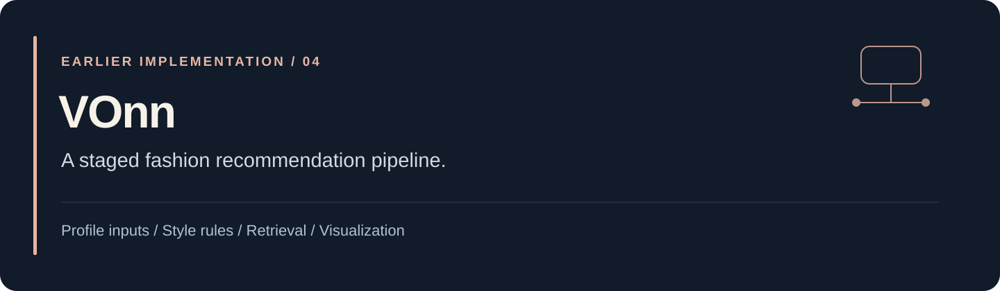
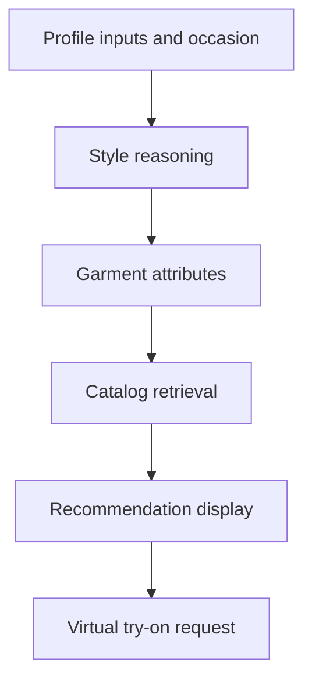

[← Portfolio](../README.md) · [Source and setup](https://github.com/jaychitransh007/TheSigmaFit4.0.0)

# VOnn: making a fashion pipeline inspectable

**Repository:** `TheSigmaFit4.0.0`. **Status:** historical implementation snapshot. **Stack:** Python, Streamlit, Google Cloud, and BigQuery.

## The problem

A fashion recommendation needs to connect several representations: a user's inputs, an occasion, a styling direction, concrete garment attributes, and products in a catalog. Generating a try-on image is another operation with its own inputs and failure modes.

This project explores those steps as a staged pipeline rather than hiding them inside a single interface call.

## Pipeline

The diagram summarizes the architecture in the repository README. It does not assert a current deployed provider, output quality, or production endpoint.

## What makes the implementation interesting

| Component | Purpose | Where to look |
| --- | --- | --- |
| Profile and context processing | Prepare the inputs used for styling. | [`app/user`](https://github.com/jaychitransh007/TheSigmaFit4.0.0/tree/main/app/user) |
| Styling | Translate context into a styling direction. | [`app/styling`](https://github.com/jaychitransh007/TheSigmaFit4.0.0/tree/main/app/styling) |
| Fashion translation | Convert a direction into garment-level attributes. | [`app/fashion`](https://github.com/jaychitransh007/TheSigmaFit4.0.0/tree/main/app/fashion) |
| Product retrieval | Find relevant catalog candidates. | [`app/products`](https://github.com/jaychitransh007/TheSigmaFit4.0.0/tree/main/app/products) |
| Virtual try-on | Integrate a separate image-generation stage. | [`app/vto`](https://github.com/jaychitransh007/TheSigmaFit4.0.0/tree/main/app/vto) |
| Interface | Expose the pipeline through Streamlit. | [`interface.py`](https://github.com/jaychitransh007/TheSigmaFit4.0.0/blob/main/interface.py) |

The main tradeoff is between explicit intermediate representations and integration complexity. Separating the stages makes them easier to inspect, but a coherent user result still depends on compatible schemas, retrieval behavior, and provider responses across the whole pipeline.

## Running the snapshot

Use the repository's setup guide for Python dependencies and cloud requirements. The documented UI entry point is `streamlit run interface.py`. Cloud-backed runs need a separately configured Google Cloud project, credentials, and service access; model availability and costs need a current check.

The source README includes a proprietary notice. Public source visibility does not by itself grant redistribution rights.

## Relationship to Vibe

VOnn is presented here as an earlier fashion-system implementation. [Vibe](vibe.md) is a separate current product case study. Their catalog assumptions, services, and feature boundaries should be read in the context of each version.

This page documents design and code organization reviewed on **23 October 2026**. It makes no benchmark claim about recommendation quality or image fidelity.
